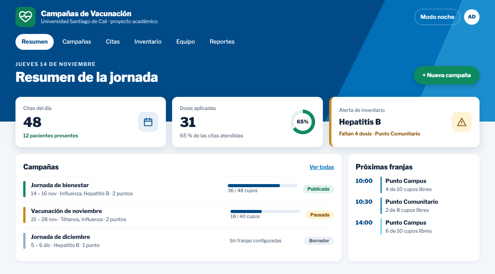
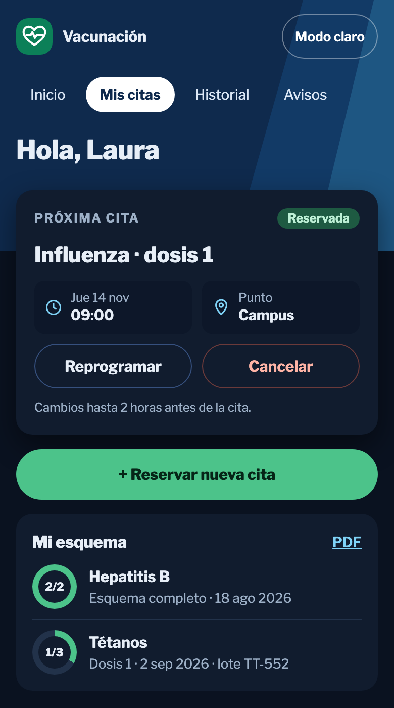

# vacunacion-app
Sistema de Gestión de Campañas de Vacunación — Mini-Proyecto I, Lenguajes de Programación 2026B. Flask + SQLite, arquitectura MVC.

## Diseño de la interfaz

Propuesta elegida por el equipo: **banda de identidad** con el azul marino de la
Universidad Santiago de Cali, verde para las acciones principales y tema claro y
noche. Las imágenes son de la maqueta (datos ficticios); las pantallas reales se
construyen módulo a módulo.

<p>
  
  
</p>

## Preparar el entorno

Requiere Python 3.10 o posterior.

```bash
python -m venv .venv
# Windows: .venv\\Scripts\\activate
# macOS/Linux: source .venv/bin/activate
pip install -r requirements.txt
python run.py
```

Al crear la aplicación se inicializa el esquema en `instance/vacunacion.db`.
La carpeta `instance/` contiene datos locales y el archivo de base está
ignorado por Git; cada integrante genera su propia base al ejecutar la app.
También se puede crear explícitamente con `flask --app run init-db`.

Para guardar la base en otra ruta, define `DATABASE_PATH`. En producción,
define además `SECRET_KEY` con un valor secreto propio.

## Esquema SQLite actual

El esquema se mantiene en `app/schema.sql` y se ejecuta con el módulo estándar
`sqlite3` (no se usa ORM). Contiene:

- `usuarios`: cuentas de administradores, vacunadores y pacientes; nombre,
  tipo y número de documento (únicos juntos), correo único, contraseña con hash
  y rol.
- `pacientes`: fecha de nacimiento, contacto y declaración del responsable
  (16–17 años); se enlaza con su cuenta en `usuarios`.
- `tokens_cuenta`: enlaces de recuperación e invitación (solo el hash; vencen
  en 30 minutos y se usan una vez).
- `vacunador_punto`: puntos asignados a cada vacunador.
- `auditoria`: quién cambió qué y cuándo, sin contraseñas.
- `vacunas`: el producto (nombre, fabricante y dosis requeridas).
- `lotes`: lotes de cada vacuna con su fecha de vencimiento.
- `puntos_vacunacion`: ubicación, horario y capacidad diaria.
- `campanas`, `campana_puntos`, `campana_vacunas`: campañas (borrador,
  publicada, pausada o finalizada) con sus puntos y vacunas.
- `franjas`: horarios de atención por punto y fecha; sus cupos se comparten
  entre todas las campañas.
- `inventarios_biologicos`: existencias por combinación de punto y vacuna
  (pasará a ser por lote con el módulo de inventario).
- `citas`: paciente, campaña, vacuna, franja y estado (reservada, presente,
  aplicada, no aplicada, registro anulado, cancelada o no asistió). Un paciente
  tiene como máximo una cita activa por vacuna.
- `dosis_aplicadas`: historial de dosis administradas.

Las citas ya no se borran en cascada: la historia se conserva. Las claves
foráneas se activan en cada conexión SQLite en `app/db.py`.

## Cuentas

Hay tres roles: **administrador**, **vacunador** y **paciente**. Cada cuenta
tiene un solo rol. Todos los comandos se ejecutan en una terminal abierta en la
carpeta del proyecto y con el entorno virtual activado:

```bash
# macOS/Linux
source .venv/bin/activate
# Windows
.venv\Scripts\activate
```

### Paciente

Cualquier persona desde los 16 años crea su cuenta en la app, con el enlace
«Crear cuenta». Entre los 16 y 17 años debe marcar la declaración de
autorización de su responsable.

### Administrador

El primer administrador se crea desde la terminal (no hay contraseñas guardadas
en el repositorio):

```bash
flask --app run crear-admin
```

El comando pregunta, uno por uno:

1. Nombre completo.
2. Tipo de documento: `CC`, `CE` o `PASAPORTE`.
3. Número de documento.
4. Correo.
5. Contraseña y su confirmación (no se ve mientras se escribe). Debe tener al
   menos 6 caracteres, con mayúscula, minúscula, número y símbolo.

Si todo está bien responde `Administrador creado.`. Solo se puede crear uno de
esta forma; si ya existe, responde `Ya existe un administrador.`

Para ingresar: `python run.py`, abrir http://127.0.0.1:5000/ingresar y usar el
tipo y número de documento con la contraseña. El administrador ve «Usuarios»
en el menú.

### Vacunador

El vacunador no se registra solo: el administrador lo invita y le asigna los
puntos donde trabaja.

1. **Debe existir al menos un punto de vacunación.** Si no hay ninguno, el
   administrador lo crea en **Puntos → Nuevo punto**.

2. Ejecutar `python run.py`, ingresar como administrador y abrir **Usuarios →
   Invitar vacunador**.
3. Llenar nombre, documento y correo, marcar uno o más puntos y pulsar
   **Invitar**.
4. El vacunador recibe un enlace para crear su contraseña. **Mientras el correo
   no esté configurado, el enlace aparece en la terminal donde
   corre `python run.py`**, en un bloque como este:

   ```text
   --- Correo para juan@example.com: Invitación al sistema de vacunación
   ...
   Usa este enlace para establecer tu contraseña: http://127.0.0.1:5000/invitacion?token=...
   ---
   ```

5. Abrir ese enlace (por ejemplo en una ventana privada, para no cerrar la
   sesión del administrador), escribir la contraseña del vacunador y guardar.
6. El vacunador ya puede ingresar con su documento y contraseña. En «Mi perfil»
   ve sus puntos asignados.

El enlace vence a los 30 minutos y solo sirve una vez. Si venció, en
**Usuarios** aparece el botón **Renovar invitación**, que genera un enlace nuevo
y anula el anterior. Los puntos de un vacunador se cambian con el enlace
**Puntos** de esa misma tabla.

### Olvidé mi contraseña

En «Ingresar» → «Olvidé mi contraseña». El enlace de recuperación también
aparece en la terminal mientras el correo no esté configurado.

## Catálogos y campañas (administrador)

Orden sugerido para preparar una campaña:

1. **Puntos → Nuevo punto:** nombre, dirección, horario y capacidad diaria.
2. **Vacunas → Nueva vacuna:** nombre, fabricante y dosis del esquema.
3. **Lotes → Nuevo lote:** vacuna, código y vencimiento. Un lote sirve hasta su
   fecha de vencimiento, inclusive.
4. **Franjas → Nueva franja:** punto, fecha, horario (dentro del horario del
   punto, sin cruzarse con otra franja) y cupos.
5. **Campañas → Nueva campaña:** datos, vacunas y puntos. Queda en borrador.
6. En la campaña, **Publicar**. Se exige al menos un punto, una vacuna y una
   franja dentro de sus fechas. Luego se puede **Pausar** (no recibe reservas
   nuevas y conserva las citas) y **Reanudar**. Al pasar su fecha final queda
   finalizada.

Los registros no se borran, para conservar el historial. Los cupos de una
franja no pueden quedar por debajo de las citas que ya la ocupan.

## Acceso a SQLite desde Flask

Usa `get_db()` para obtener la conexión de la petición actual. Los resultados
se pueden leer por nombre de columna (`fila["nombre_completo"]`). Flask cierra
la conexión al terminar el contexto de la petición. Al añadir modelos,
mantenlos sobre esta conexión y usa consultas parametrizadas (`?`) para
valores de usuario.

## Pruebas

Las pruebas usan pytest y una base temporal (nunca `instance/vacunacion.db`).

```bash
pip install -r requirements-dev.txt
pytest -q
```

Cuando cambie `app/schema.sql`, borren su `instance/vacunacion.db` local y
vuelvan a ejecutar la app para regenerarla (los datos son ficticios).
